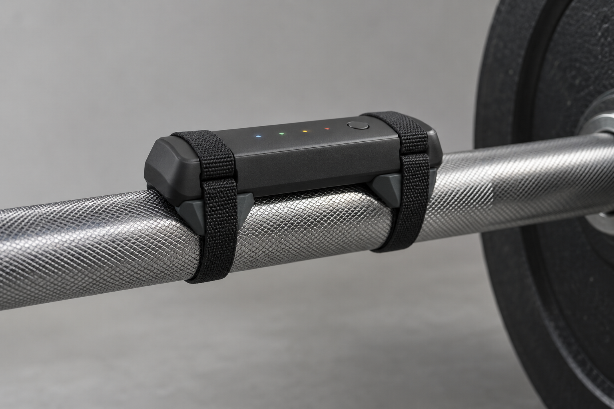
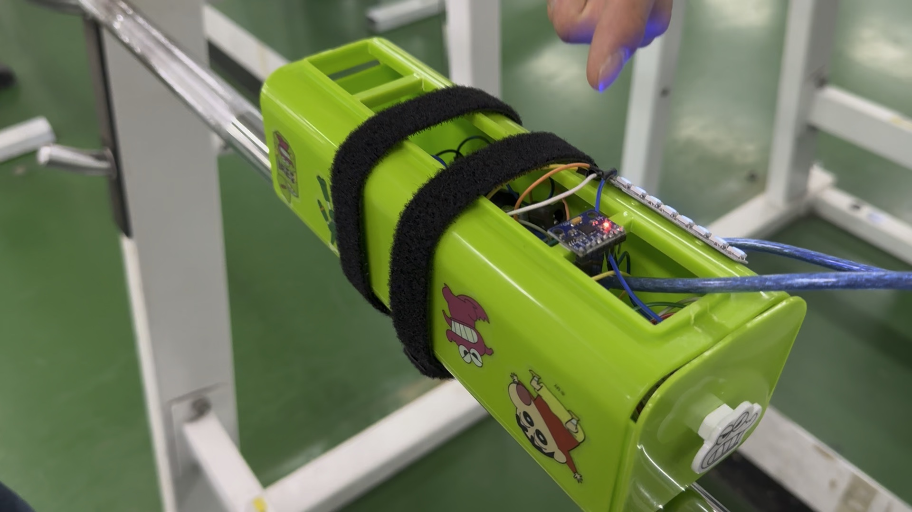
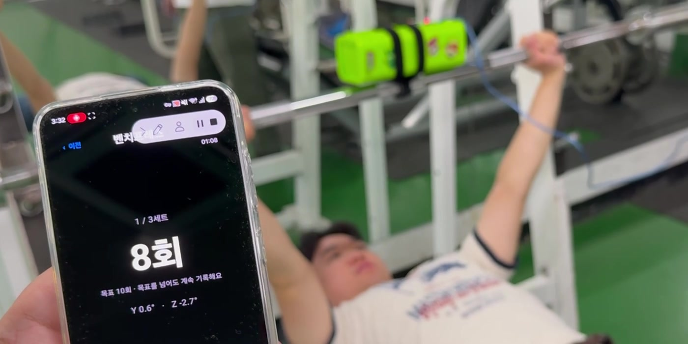
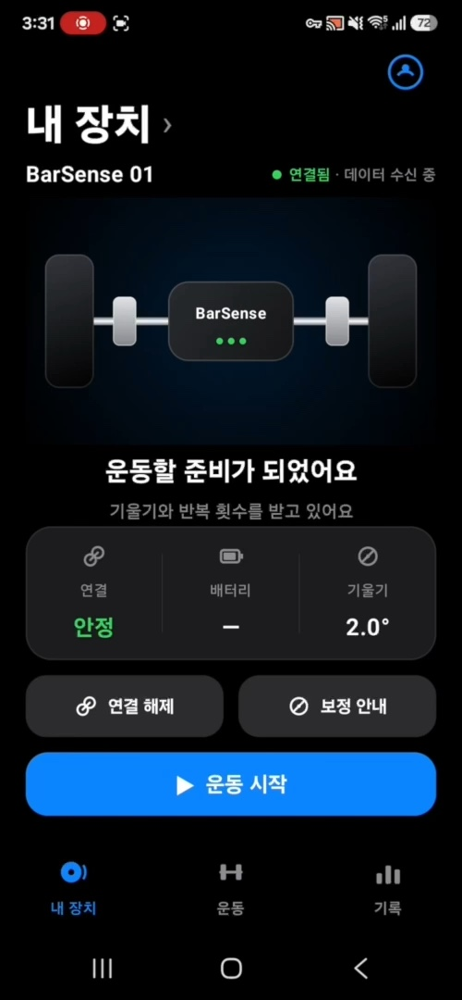
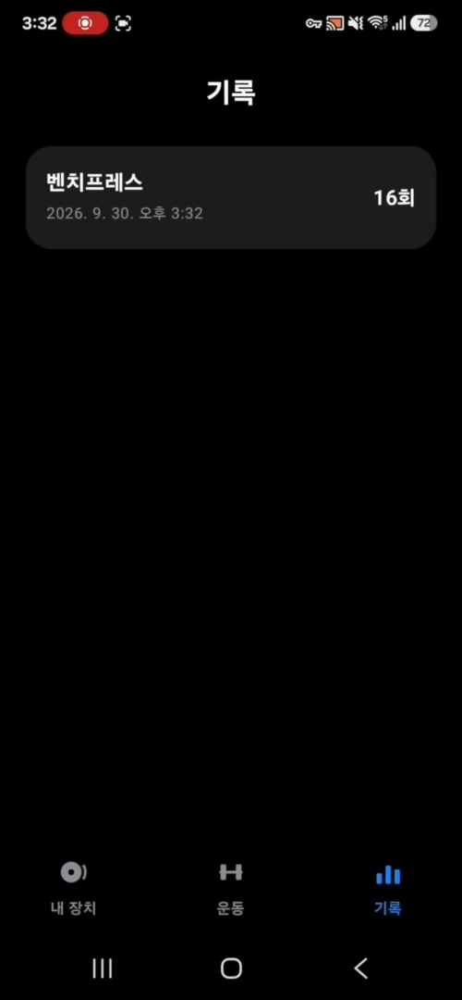
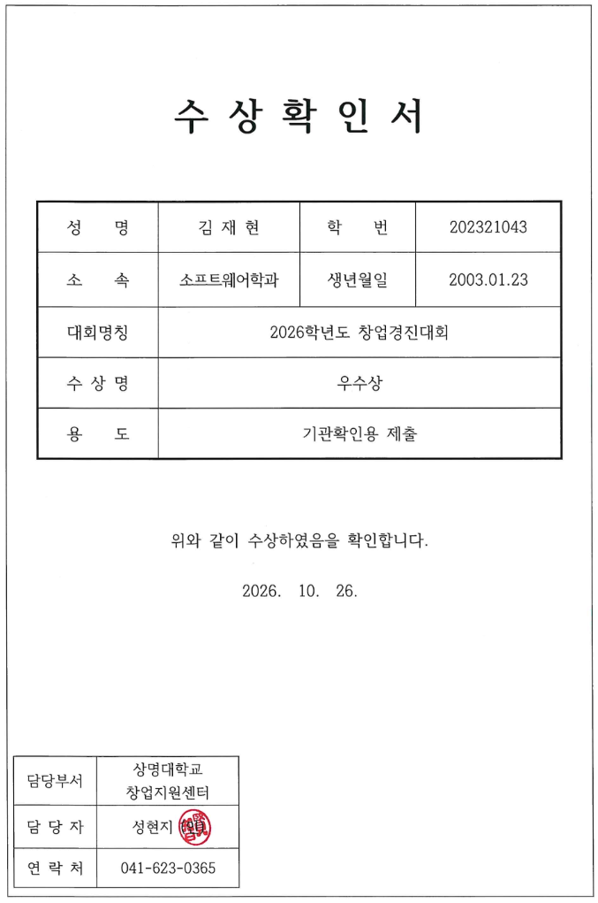

# 🏋️ BarSense

> **바벨에 부착해 운동 중 기울기와 반복 횟수를 확인하고, 세트·휴식·운동 기록을 관리하는 센서와 앱**

BarSense는 혼자 바벨 운동을 할 때 봉의 기울기를 확인하기 어렵고,
운동 후 반복 횟수와 세트를 다시 기록해야 하는 불편에서 시작한 프로젝트입니다.

바벨에 부착한 센서에서 움직임 데이터를 수집하고,
모바일 앱에서 기울기와 반복 횟수를 확인한 뒤 운동 기록으로 저장하는 흐름을 구현했습니다.

  
   
  BarSense 소형화 제품 구상 · 제작 전 개념 렌더

---

## 🔍 Project Overview

BarSense의 기본 사용 흐름은 다음과 같습니다.

`바벨에 장치 부착`
→ `운동 종목 선택`
→ `기울기와 반복 횟수 확인`
→ `사용자가 세트 종료`
→ `실제 횟수 확인 및 수정`
→ `휴식 및 운동 기록 저장`

전문적인 속도·파워 분석 장비보다
일반 운동자가 쉽게 사용할 수 있는 운동 확인과 기록 기능에 초점을 두었습니다.

---

## 🛠 Current Prototype

현재 목업은 다음 부품으로 구성했습니다.

- Arduino Uno
- MPU-6050 관성 센서
- HC-06 Bluetooth Classic 모듈
- NeoPixel LED
- LCD
- 스트랩 기반 바벨 부착 구조
- USB 전원

  
   
  Arduino Uno와 센서로 제작한 실제 기능 검증 목업

센서에서 측정한 바벨의 Y/Z축 기울기와 누적 반복 횟수를
Android 앱으로 전송하는 구조입니다.

`MPU-6050` → `Arduino Uno` → `HC-06` → `Android App`

현재 목업에서는 갤럭시 기기와 연결해 기울기 변화를 실시간으로 확인하고,
운동 선택부터 세트 종료·휴식·기록 저장까지 이어지는 흐름을 구현했습니다.

  

---

## 📱 Key Features

- 바벨의 Y/Z축 기울기 실시간 표시
- 센서 기반 누적 반복 횟수 확인
- 운동 종목 수동 선택
- 사용자가 직접 세트를 종료하는 기록 방식
- 실제 수행 횟수 확인 및 수정
- 세트 종료 후 휴식 시간 확인
- 운동별 기록 저장·조회·삭제
- Bluetooth 연결 상태와 센서 데이터 수신 상태 구분
- LED와 LCD를 활용한 장치 상태 표시

  
  

---

## 🖥 Mobile Applications

### Android

Kotlin과 Jetpack Compose를 사용해
실제 센서 연결이 가능한 Android 앱을 개발했습니다.

- HC-06 Bluetooth Classic 연결
- 센서 데이터 파싱
- 기울기와 반복 횟수 표시
- 운동 선택 및 세트 진행
- 수동 세트 종료
- 휴식 및 기록 관리

### iOS

SwiftUI를 사용해 동일한 운동 흐름과 UI 구조를 구현했습니다.

현재 iOS 앱은 화면과 기록 흐름까지 구현된 상태이며,
실제 센서 연동은 HC-06이 아닌 BLE 기반 장치로 전환한 뒤 검증할 계획입니다.

---

## 👨‍💻 My Role

프로젝트에서 **대표와 소프트웨어 개발**을 담당했습니다.

### Development

- Android 앱 기능 개선
- iOS 앱 화면과 운동 기록 흐름 구현
- 센서 데이터와 앱 사이의 통신 구조 설계
- 운동 선택·세트 종료·휴식·기록 저장 흐름 구성
- 실제 수행 횟수 확인 및 수정 방식 설계

### Product Planning

- 프로젝트 일정과 사업화 방향 정리
- 사업계획서와 발표자료 제작
- 제품 원가와 초기 검증 계획 수립
- 실제 목업과 향후 제품 설계 범위 구분

---

## 🔄 Challenges & Iteration

### Bluetooth Platform Difference

현재 사용한 HC-06은 Bluetooth Classic 모듈이기 때문에
Android 연결에는 사용할 수 있지만 iPhone의 BLE 통신에는 그대로 사용할 수 없습니다.

따라서 소형화 제품에서는
ESP32-C3 기반 BLE 구조로 전환하는 방향을 설계했습니다.

### Manual Set Completion

현재 센서 데이터에는 자동 세트 종료를 안정적으로 판단하는 데 필요한
원시 가속도·자이로 데이터와 시간 정보가 포함되지 않습니다.

정확도가 확인되지 않은 자동화 기능을 먼저 적용하기보다,
사용자가 세트를 직접 종료하고 실제 반복 횟수를 확인하는 방식을 MVP에 적용했습니다.

### Prototype Size

현재 목업은 Arduino Uno·브레드보드·USB 전원을 사용하기 때문에
실제 휴대 제품으로 사용하기에는 크기가 큽니다.

이를 개선하기 위해 ESP32-C3, BMI270, 배터리와 충전 회로를 사용하는
소형화 구조를 검토했습니다.

---

## 🚀 Productization Plan

후속 제품의 목표 구조는 다음과 같습니다.

- ESP32-C3 기반 BLE 통신
- BMI270 6축 IMU
- 약 80×25mm PCB 배치안
- 약 90×32×20mm 본체 목표
- 독립 스트랩 2개
- 바벨 회전을 줄이기 위한 접촉 리브
- 배터리와 USB-C 충전 구조

상단 대표 이미지는 실제 완성품 사진이 아닌 **제작 전 소형화 개념 렌더**입니다.
KiCad 파일도 회로와 배선이 완성된 제작용 PCB가 아니라 부품 배치 검토안입니다.

---

## 🧪 Validation Status

### 현재까지 확인한 내용

- Arduino 센서 목업 제작
- Android 앱과 Y/Z축 기울기 실시간 연동
- 운동 선택·수동 세트 종료·휴식·기록 흐름 구현
- 벤치프레스와 스쿼트 시연 자료 확보
- iOS와 Android 앱 UI 구현
- Arduino 펌웨어와 모바일 앱 소스 정리
- 소형화 제품의 기구·PCB 배치 방향 설계

### 추가 검증이 필요한 내용

- 운동별 반복 횟수 정확도
- 장시간 Bluetooth 연결 안정성
- BLE 기반 iOS 실센서 연결
- 배터리와 충전 회로
- 금속 바벨에 부착했을 때의 BLE 수신 안정성
- 스트랩의 회전·풀림·진동 안전성
- 자동 세트 종료 기능

---

## 📌 Result

- 바벨 부착형 센서 목업 제작
- Android 실시간 기울기 연동 구현
- 운동 세트·휴식·기록 관리 앱 개발
- iOS·Android·Arduino 소스 구성
- 소형화 제품 개념과 초기 PCB 배치안 설계
- 사업계획서와 제품화 검증 계획 수립
- **2026학년도 상명대학교 창업경진대회 우수상 수상** 🏆

  

---

## 🛠 Tech Stack

**Application**  
`Kotlin` `Jetpack Compose` `Swift` `SwiftUI`

**Embedded & Hardware**  
`Arduino Uno` `Arduino C++` `MPU-6050` `HC-06` `NeoPixel` `LCD`

**Design & Product Planning**  
`Bluetooth Classic` `KiCad` `Hardware Prototyping`

**Future Product Concept**  
`ESP32-C3` `BLE` `BMI270`
