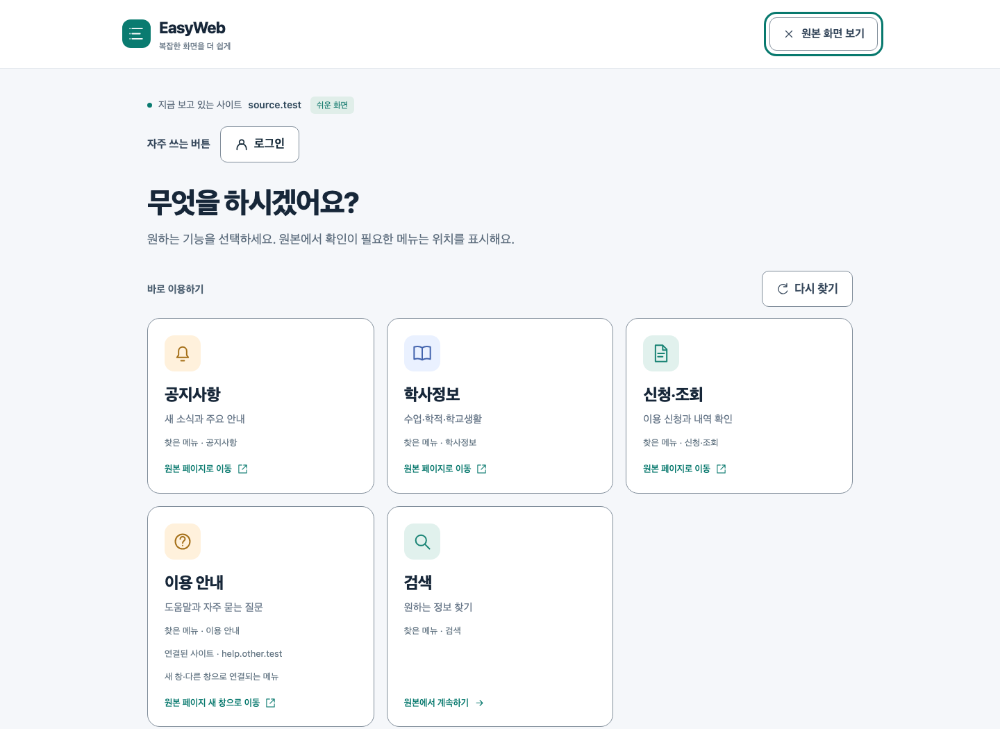
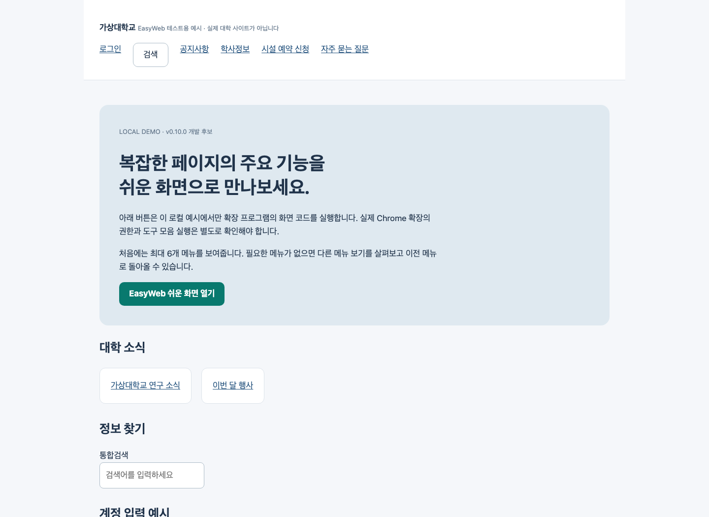
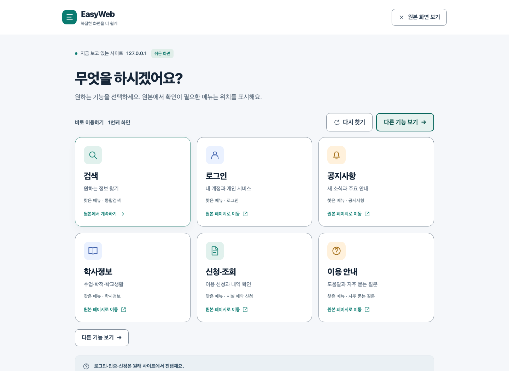
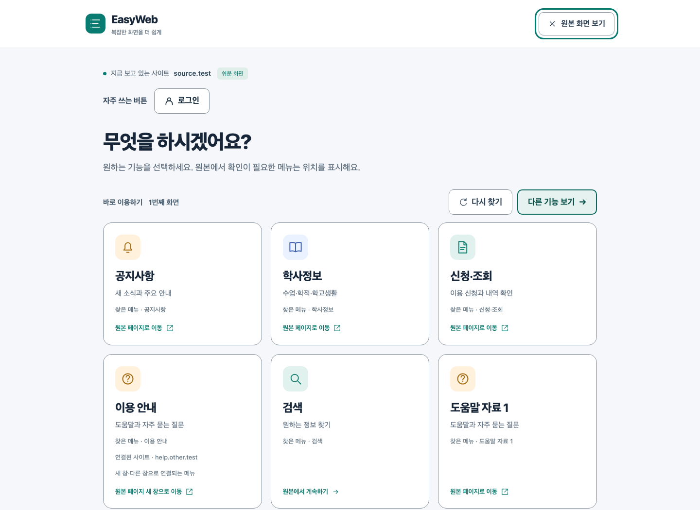
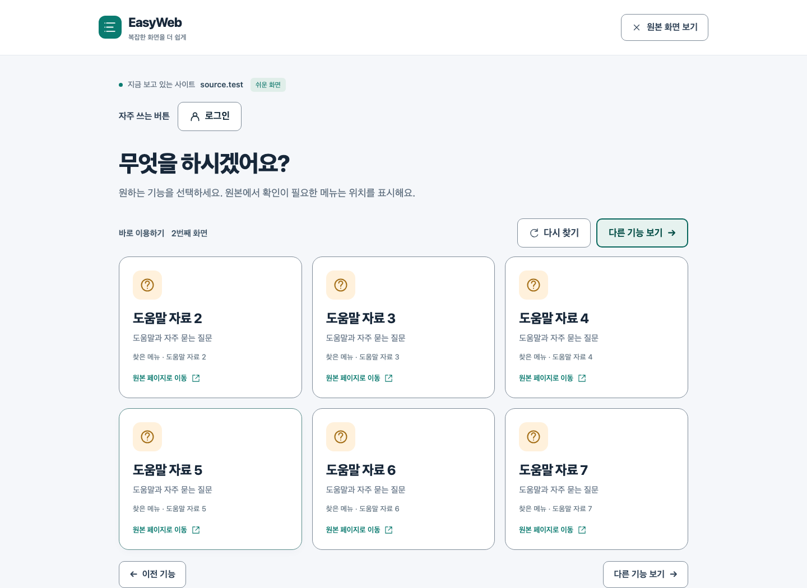
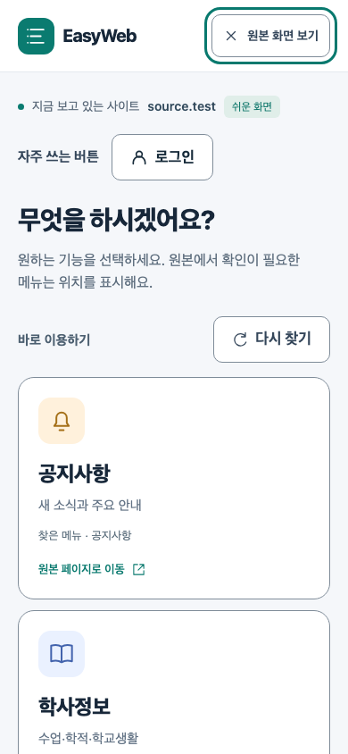

# 🌐 EasyWeb

> **복잡한 기관 홈페이지에서 주요 기능을 찾아 큰 버튼으로 다시 보여 주는 접근성 중심 Chrome 확장 프로그램**

EasyWeb은 학교·시청·공공기관 홈페이지에서
로그인, 검색, 공지사항, 신청과 같은 기능을 찾기 어려운 사용자를 위한 프로젝트입니다.

기존 웹사이트를 새로 만들거나 내용을 대신 처리하지 않고,
현재 페이지에 실제로 존재하는 기능을 찾아 이해하기 쉬운 카드 화면으로 다시 구성합니다.

  
   
  최신 v0.11 개발 화면 · 자동 접근성 검증용 합성 페이지

---

## 🔍 Project Overview

EasyWeb의 기본 흐름은 다음과 같습니다.

`사용자가 확장 프로그램 실행`
→ `현재 페이지의 보이는 기능 분석`
→ `주요 기능 분류 및 중복 제거`
→ `큰 카드로 최대 6개 표시`
→ `페이지 이동 또는 원본 위치 안내`

사이트별로 고정된 메뉴를 등록하는 방식이 아니라,
페이지의 링크·버튼·검색창 이름과 주변 제목, 위치와 본문 관계를 분석하는
규칙 기반 구조로 개발하고 있습니다.

---

## 💡 Problem

기관 홈페이지에는 실제 업무 메뉴뿐 아니라
홍보 배너, 뉴스, 행사, SNS와 여러 단계의 메뉴가 한 화면에 함께 표시됩니다.

이 때문에 웹 사용이 익숙하지 않거나 작은 글씨와 버튼을 보기 어려운 사용자는
필요한 메뉴가 페이지에 있어도 어디에서 시작해야 하는지 찾기 어렵습니다.

EasyWeb은 화면 전체를 단순히 확대하는 대신,
**지금 필요한 기능을 먼저 찾고 선택할 수 있는 별도의 쉬운 화면**을 제공합니다.

  
  
   
  로컬 가상대학교 예시의 원본 화면과 EasyWeb 적용 화면 비교

---

## 🧩 How It Works

### 1. 주요 기능 찾기

현재 페이지에서 보이는 링크·버튼·검색창을 수집하고,
안전한 이름과 URL, 주변 제목과 본문 관계를 기준으로 기능을 분류합니다.

기본 분류는 다음과 같습니다.

- 로그인
- 검색
- 공지사항
- 학사정보
- 신청·조회
- 이용 안내

페이지에 실제로 존재하고 근거가 있는 기능만 보여 주며,
없는 기능을 임의로 만들지 않습니다.

### 2. 쉬운 화면 구성

찾은 기능은 큰 글씨와 넓은 클릭 영역을 가진 카드로 보여 줍니다.
처음 화면에는 최대 6개를 표시하고,
추가 기능은 `다른 기능 보기`와 `이전 기능`을 통해 확인할 수 있습니다.

홈·게시판 목록·게시글·관문 페이지처럼
페이지 목적이 다른 경우에는 페이지 유형에 맞춰 카드 구성을 조정합니다.

  
  
   
  첫 기능 화면과 다른 기능 보기 화면

### 3. 원본 기능과 안전하게 연결

일반 HTTP(S) 링크는 원래 주소로 이동합니다.

JavaScript 버튼, 팝업, 다운로드, 인증, 같은 페이지 안의 기능처럼
자동 실행에 위험이 있는 요소는 EasyWeb이 대신 누르지 않고
원본 위치로 이동해 강조한 뒤 사용자가 직접 선택하도록 합니다.

페이지가 바뀌거나 원본 요소가 사라진 경우에는
이전 카드를 실행하지 않고 `다시 찾기`를 안내합니다.

---

## 🖥 Key Features

- 현재 페이지의 링크·버튼·검색창 분석
- 규칙 기반 주요 기능 분류와 우선순위 결정
- 목적지가 같은 기능과 반복 메뉴 중복 제거
- 큰 카드 중심의 쉬운 화면
- `자주 쓰는 버튼`과 `다른 기능 보기`
- 페이지 유형별 첫 화면 구성
- 일반 링크 직접 이동
- 실행형 기능의 원본 위치 안내
- 원본 변경 감지와 오래된 카드 실행 차단
- Esc 또는 `원본 화면 보기`를 통한 즉시 복귀
- 키보드 초점과 좁은 화면 재배치
- 강제 색상과 모션 감소 환경 대응

  
   
  390px 모바일 너비에서 재배치된 쉬운 화면

---

## 🛠 Architecture

EasyWeb은 Manifest V3 기반 Chrome 확장 프로그램으로 구성했습니다.

`Chrome Extension 실행`
→ `activeTab 권한으로 현재 탭에 주입`
→ `DOM 분석`
→ `기능 분류·순위 결정`
→ `Shadow DOM 쉬운 화면 표시`
→ `페이지 이동 또는 원본 위치 안내`

### Main Modules

- `analyzer` — 보이는 기능과 안전한 이름 수집
- `classifier` — 기능 분류와 근거 점수 계산
- `ranker` — 중복 제거와 첫 화면 우선순위 결정
- `page-types` — 게시판·게시글·관문 등 페이지 유형별 구성
- `easy-mode` — 큰 카드 기반 UI와 키보드 초점 관리
- `action-policy` — 직접 이동과 원본 위치 안내 구분
- `page-session` — 원본 변경 감지와 오래된 카드 차단
- `action-bridge` — 원본 요소로 이동·초점·강조

---

## 🔒 Safety & Privacy

사용자의 중요한 작업을 확장 프로그램이 자동으로 실행하지 않도록
다음 경계를 적용했습니다.

- 로그인·신청·결제·삭제·폼 제출을 대신 실행하지 않음
- 입력창의 값과 편집 내용을 읽지 않음
- 분석 결과를 서버로 전송하지 않음
- 쿠키와 확장 저장소를 사용하지 않음
- 화면을 닫으면 분석 결과도 메모리에서 제거
- `activeTab`과 `scripting` 권한만 사용
- 원본이 변경되면 기존 카드 실행 차단

분류·순위는 원격 AI가 아니라 규칙 기반으로 처리합니다.
로컬 AI와 소형 분류 모델은 개발 과정에서 비교 실험만 진행했고,
현재 제품에는 포함하지 않았습니다.

---

## 👨‍💻 My Role

EasyWeb은 **기획부터 개발, 검증 체계와 문서화까지 직접 진행한 개인 프로젝트**입니다.

### Planning & UX

- 고령·중장년 사용자의 기관 홈페이지 메뉴 탐색 문제 정의
- 최대 6개 카드와 다른 기능 보기 흐름 설계
- 자주 쓰는 버튼과 페이지 유형별 화면 구성
- 원본 화면으로 안전하게 돌아가는 사용자 흐름 설계

### Development

- TypeScript 기반 Chrome 확장 프로그램 구현
- DOM 분석과 기능 분류·순위 엔진 개발
- Shadow DOM 기반 쉬운 화면 UI 구현
- 직접 이동과 원본 위치 안내 정책 구현
- 원본 변경 감지와 입력 정보 제외 로직 개발

### Validation

- Playwright 기반 회귀 테스트 작성
- axe-core 기반 자동 접근성 검사 구성
- 키보드·좁은 화면·강제 색상·모션 감소 상태 검증
- 합성 성능 벤치마크와 기관 페이지 평가 도구 개발
- 첫 실패 결과와 개발 재평가를 구분해 기록

---

## 🧪 Validation & Limitations

현재 EasyWeb은 **v0.11 개발 중인 파일럿 후보**입니다.

### 현재까지 확인한 내용

- 최신 개발 소스 기준 로컬 회귀 테스트 529개 통과
- 자동 접근성 검사 21조건 통과
- 320·390·720·1440 CSS px 화면 재배치 검사
- 키보드 초점과 원본 복귀 흐름 검사
- 개발에 사용한 기관 페이지 자료 기반 분류·추천 평가
- 1,000개 제어 합성 페이지 성능 검사
- 실제 페이지 유형 조사를 기반으로 게시판·게시글·관문 화면 개선

### 추가 검증이 필요한 내용

- 새로운 독립 자료를 사용한 분류·추천 품질 평가
- 실제 Chrome 확장 설치와 복구 절차 확인
- 실제 VoiceOver 발화
- 브라우저 200%·400% 확대
- 대상 사용자 사전 시험과 6~8명 비교 실증
- Windows Chrome 지원 범위
- 기관 담당자 인터뷰와 도입 가능성 검토

자동 테스트와 개발 자료의 결과는
실제 사용자 성공이나 독립 품질 인수를 의미하지 않습니다.

---

## 📌 Current Result

- 주요 기능 탐지·분류·순위 엔진 구현
- 최대 6개 카드와 다른 기능 보기 UI 구현
- 페이지 유형별 카드 구성 적용
- 원본 이동·위치 안내·변경 감지 구조 구현
- 개인정보 비수집과 최소 권한 구조 적용
- 자동 접근성·회귀·성능 검증 환경 구축
- 설치 가능한 Chrome 확장 빌드 생성
- v0.11 개발과 실제 사용자 검증 준비 진행 중

---

## 🛠 Tech Stack

**Extension** 
`TypeScript` `Chrome Extension Manifest V3` `Shadow DOM`

**Testing & Validation** 
`Playwright` `axe-core` `Headless Chromium`

**Build & Tooling** 
`Node.js` `esbuild` `npm`

**Design Principles** 
`Accessibility` `Keyboard Navigation` `Privacy by Design` `Rule-based Classification`
